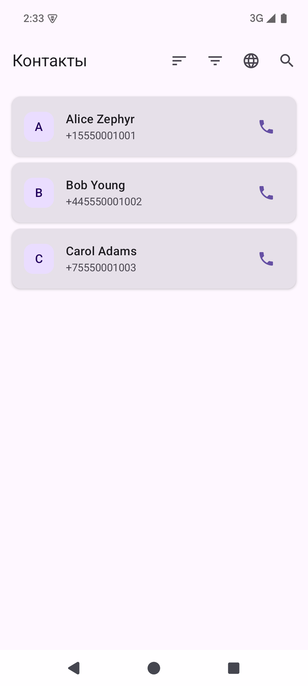
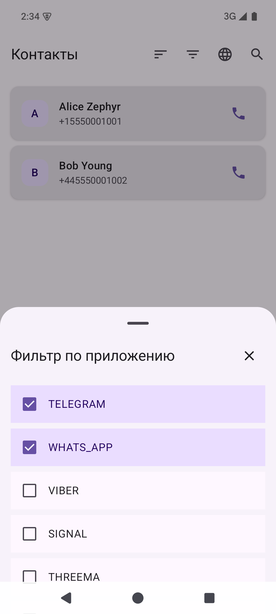
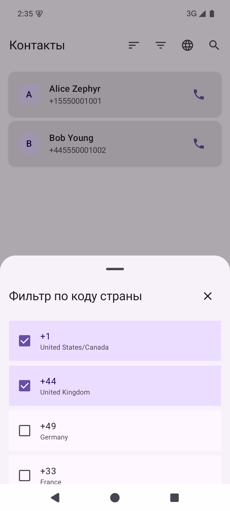
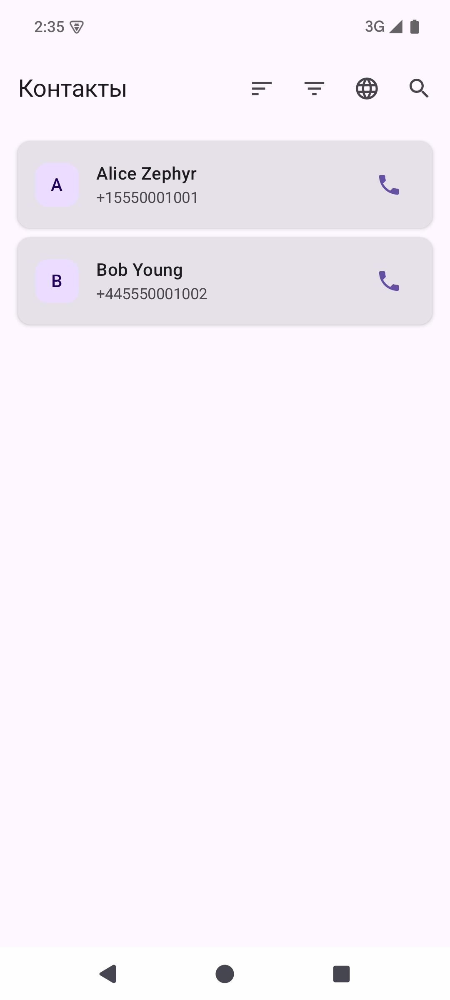
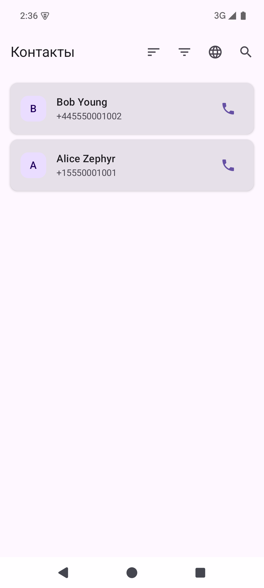

# Контакты — рефакторинг на дженерики

Проектная работа спринта 2 Яндекс Практикума. Экраны выбора кодов стран и мессенджеров используют общий типобезопасный компонент `CommonBottomSheet<T>`. В обоих фильтрах можно выбрать несколько значений; сортировка по имени и фамилии остаётся доступной при включённых фильтрах.

## Как запустить

1. Откройте проект в Android Studio и дождитесь синхронизации Gradle.
2. Запустите конфигурацию `app` на эмуляторе или Android-устройстве.
3. Разрешите приложению доступ к контактам. Для проверки фильтрации добавьте на устройство контакты с разными международными кодами телефонов.

Для проверки из терминала:

```bash
./gradlew clean assembleDebug
./gradlew lintDebug
./gradlew connectedDebugAndroidTest -Pandroid.testInstrumentationRunnerArguments.class=ru.yandex.practicum.contacts.ContactsProjectTest
```

Последняя проверка на эмуляторе API 35: чистая сборка успешна, `lintDebug` завершился успешно, оба инструментальных теста прошли. Тесты проверяют множественный выбор, повторное открытие листов, быстрое переключение, совместную фильтрацию и сортировку без сброса фильтров. Lint оставляет рекомендации об обновлении версий Android и библиотек.

## Скриншоты

Снимки сделаны 1 ноября 2026 года на эмуляторе с тремя **вымышленными** контактами: Alice Zephyr (`+1`), Bob Young (`+44`) и Carol Adams (`+7`).

| Исходный список: 3 контакта | Выбраны два мессенджера |
| --- | --- |
|  |  |

| Выбраны два кода страны | После фильтра: 2 контакта | Сортировка по фамилии |
| --- | --- | --- |
|  |  |  |

В исходном проекте набор мессенджеров для контактов назначается случайно при загрузке. Скриншот показывает сохранение выбора двух приложений в одной сессии; проверка совместной фильтрации в инструментальном тесте использует фиксированный набор контактов.
